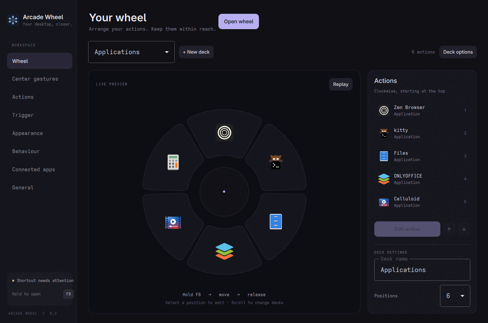

<p align="center">
  
</p>

<h1 align="center">Arcade Wheel</h1>

<p align="center">A radial launcher for the desktop. Hold a key, flick toward an action, release.</p>

<p align="center">
  <a href="https://github.com/qa-p1/Arcade-wheel/releases/latest"></a>
  <a href="https://github.com/qa-p1/Arcade-wheel/actions/workflows/ci.yml"></a>
</p>

---

Arcade Wheel is a small background launcher that works like a game weapon wheel. Hold a global shortcut and a wheel of actions appears. Move the pointer toward one and release the key to run it. Release in the center and the wheel closes without doing anything. Scroll while holding to switch decks. Click, double-click, triple-click, or long-press the center to run whole groups of apps at once.

It targets **Linux Wayland (especially Hyprland)** on x86_64, **Windows** (x64), and **macOS 13+** (Apple Silicon and Intel). It is written in C++20 with Qt 6 and Qt Quick.

<p align="center"></p>

## Download and install

Download the file for your system from [Releases](https://github.com/qa-p1/Arcade-wheel/releases). Or install it from **[Arcade Tools](https://github.com/qa-p1/Arcade-tools) → Apps**, which can also update and remove it.

| Platform | File | How to install |
| --- | --- | --- |
| Linux x86_64 | `ArcadeWheel-<version>-Linux-x86_64.AppImage` | Make it executable and run it. Before Settings opens it asks **Install Arcade Wheel?** and installs to `~/Applications/Arcade/Arcade-Wheel.AppImage`, adds a launcher and icons, a `~/.local/bin/arcade-wheel` command and an optional start at login (off by default). **Just run it once** skips installing. |
| Windows 10/11 x64 | `ArcadeWheel-<version>-Windows-x64-Setup.exe` | Run Setup. Installs for your user without admin, adds a Start menu entry, a PATH command and an install receipt, and offers optional desktop and start-at-login shortcuts. |
| Windows x64, portable | `ArcadeWheel-<version>-Windows-x64.zip` | Extract the entire ZIP and run `arcade-wheel.exe` inside it. Keep its DLLs and plugin directories together. Does not install integration. |
| macOS 13+, Apple Silicon | `ArcadeWheel-<version>-macOS-arm64.dmg` | Open the dmg and drag Arcade Wheel to Applications. Started from Downloads or the dmg, it offers **Move to Applications**. |
| macOS 13+, Intel | `ArcadeWheel-<version>-macOS-x86_64.dmg` | Same as above. |

- Scripted Linux install: `./ArcadeWheel.AppImage --install --silent --no-launch`. To repair launchers or a moved AppImage, run that copy with `--repair`. `--integration-status` prints the receipt, entries and PATH status without changing them.
- If your command folder is not on PATH, the installer shows the exact line for your shell; Wheel never edits shell profiles.
- Qt, QML imports, plugins, and the necessary application libraries are bundled. The AppImage targets Ubuntu 22.04 or newer compatible distributions; the desktop must provide a Wayland compositor and a GlobalShortcuts portal.
- Builds are unsigned: Windows installers have no publisher certificate and macOS bundles are ad-hoc signed, without notarization. On Windows, SmartScreen may warn: choose **More info → Run anyway**. On macOS, Control-click or right-click the app and choose **Open** the first time.
- If FUSE is missing on Linux, run the AppImage with `--appimage-extract-and-run`. Keep the AppImage outside temporary folders before enabling start on login.

See [Install and start Arcade Wheel](docs/user/getting-started.md) and [packaging and release details](docs/PACKAGING.md).

## Features

- **Hold → move → release.** You don't have to aim at an icon; each action owns a whole slice of the circle.
- **Decks.** Up to 8 actions per deck, any number of decks. Scroll while holding the trigger to switch.
- **Center gestures.** Single-click, double-click, triple-click, and long press in the hub can each run a group of up to 16 apps or actions.
- **Actions:** launch or focus applications, run commands, open URLs, files, or folders, system actions (lock, suspend, log out, power off, screenshot), media keys, compositor actions, and actions from other Arcade apps.
- **Live settings.** Changes apply to the running wheel immediately, and the Wheel page has a live preview.
- **Plain JSON config**, saved atomically, with versioned migrations and import/export.
- **Quiet UI.** The wheel shows action icons, a center label, and deck dots. Nothing else.

More in [Set up decks, actions and gestures](docs/user/features.md).

## Works with other Arcade apps

Wheel works on its own. It connects to other installed Arcade apps automatically over Arcade Link, **without needing Arcade Tools**. **Settings → Connected apps** controls discovery and individual peers. Missing or disabled peers leave saved slots intact with a reason.

| App | What Wheel does with it |
| --- | --- |
| Arcade Box | Save a Box tool, preset or saved pipeline in a slot. Wheel can pass clipboard content, a Lens selection or a Look file selection as input. |
| Arcade Clipboard | Use a compatible Clipboard action, or clipboard content as input. Wheel snapshots the clipboard only when you invoke the action. |
| Arcade Find | Save compatible Find actions in a slot. |
| Arcade Lens | Save Lens actions in a slot, or ask Lens to capture first and pass the selection to another action. |
| Arcade Look | Save Look actions in a slot; Look can resolve the current file-manager selection where it publishes that resolver (not on Linux). |
| Arcade Shelf | Save Shelf actions in a slot, including actions that open Shelf or use a named collection. |
| Arcade Tools | Install, update or remove Wheel from its **Apps** tab. Connected apps can offer a **Get** link for an app that isn't installed. |

The action picker shows each action's effects, including ↗ for actions that send content out. **Activity** shows progress, results and errors, and can cancel a request. Other apps can offer an action through `wheel.add_action`, which opens a draft and requires a chosen slot and confirmation. `wheel.show` opens the wheel.

When Arcade Tools is running, its tray icon hosts Wheel's menu, including **Show Wheel**. When Tools quits, Wheel's own icon returns immediately (after a five-second grace period if Tools announces a restart). Turning Link off also restores it.

See [how the Arcade apps connect](docs/user/with-other-apps.md) and [Arcade Link actions and platform support](docs/ARCADE_LINK.md).

## Usage

Closing Settings leaves the wheel running. When the desktop has a system tray, the tray icon opens Settings on click. Its menu offers **Show Wheel**, **Open Settings**, **Restart Arcade Wheel** and **Quit Arcade Wheel**. The default shortcut is **F8**, and the desktop may ask you to approve it the first time.

- **Hold** the shortcut. The wheel opens in the middle of the screen the pointer is on, and the pointer jumps to its center.
- **Move** toward an action. It highlights and its name appears in the center.
- **Release** to run it. Releasing in the center closes the wheel without doing anything.
- **Scroll** while holding to change decks.
- **Right-click** or **Escape** to cancel.

The first deck, **Applications**, starts with up to six of your installed graphical apps; any remaining slots are left empty for you to fill. **Settings → Trigger** records a different trigger and can set a hold threshold. See the [shortcut reference](docs/user/shortcuts.md).

### Center gestures

Open **Settings → Center gestures** to assign a group of apps or actions to **Single-click**, **Double-click**, **Triple-click**, or **Long press**. Each group has a name, an enabled switch, and up to 16 actions that run in order. All gestures start unassigned.

While holding the trigger, use the left mouse button on the wheel's center:

- The group runs as soon as the gesture is recognized, and the wheel closes. Releasing the trigger afterward does not run anything a second time.
- With **no** single-click group, a single center click still closes the wheel.
- A click waits for the **time between clicks** if a longer gesture could still follow. Releasing the trigger runs whatever is pending right away.
- Moving out of the center, right-clicking, or scrolling to another deck cancels a pending gesture.

Groups are saved with the rest of the configuration and included in import/export. If one action fails, the rest of the group still runs and the error is reported.

### Command-line reference

When Arcade Wheel is already running, each command is sent to the running instance.

| Command | Effect |
| --- | --- |
| `--settings` | Open Settings (default when no argument is given) |
| `--background` | Start without opening any window |
| `--show` | Open the wheel in click mode; click an action, right-click to cancel |
| `--preview` | Show the real overlay in a safe mode that never runs actions |
| `--cancel` | Close the wheel |
| `--press` / `--release` | Simulate the trigger (`--release` **does** run the selected action) |
| `--status` | Print the running instance's status as JSON |
| `--restart` / `--quit` | Restart or quit the running instance |
| `--menu` | Print app-specific tray items as JSON |
| `--settings-export FILE` | Export portable settings without credentials or device identity |
| `--settings-import FILE` | Import portable settings after saving a private backup |
| `--install [--silent] [--no-launch] [--channel C]` | Install this AppImage / macOS bundle |
| `--uninstall [--silent] [--remove-data]` | Remove the installation |
| `--repair` | Repair launchers and entries |
| `--integration-status` | Show receipt, integration entries and PATH status |
| `--version` | Print the version |
| `--arcade-manifest` | Print the Arcade Link manifest (no side effects) |

## Settings and data

The configuration is a versioned JSON file. Its path is shown on the **General** settings page (on Linux, `~/.config/Arcade Wheel/config.json`). It is written atomically. Deck and action IDs stay the same when you reorder them, and unknown action types are kept rather than dropped. If the file can't be parsed, it is backed up next to the original before defaults are loaded.

Commands run as a program plus arguments, not through a shell. Use `sh -c '…'` explicitly if you need shell syntax.

Portable settings (`--settings-export`, or Arcade Tools) include preferences, decks, slots and center gestures. **Never exported:** credentials, tokens, secrets and device identity are stripped from action options. Import validates the file, saves a private backup and applies without restarting.

## Uninstall

- **Linux:** run `arcade-wheel --uninstall`, use the launcher's **Uninstall** action, or remove Wheel in Arcade Tools.
- **Windows:** **Settings → Apps** (Apps & features), or Arcade Tools. The CLI `--uninstall` uses the native uninstaller recorded in the install receipt.
- **macOS:** `arcade-wheel --uninstall` removes the installation recorded in its receipt, or remove Wheel in Arcade Tools.

Settings stay unless you pass `--remove-data`.

## Platform notes

- **Wayland:** global press and release events come from the XDG GlobalShortcuts portal. LayerShellQt provides the overlay layer.
- **Hyprland:** the pointer position is read over compositor IPC (generic Wayland clients can't query it), and the pointer is moved to the wheel center when it opens. Other Wayland desktops can only provide a best-effort position and may not move the pointer.
- **Windows:** a narrowly scoped, passive keyboard hook watches only the configured trigger. It doesn't record keys or block normal input. Caps Lock tap passthrough and mouse-button triggers are not supported.
- **macOS:** a registered global keyboard shortcut supplies press/release events; Settings can record a replacement when F8 is reserved by the OS (some keyboards require Fn+F8). Application discovery, launch/focus, the overlay, and optional login startup are implemented. Screenshot and sleep actions are supported; other system/media/compositor actions and mouse/modifier-only triggers are not available yet.
- Fullscreen games or apps with exclusive input may block the overlay or the shortcut, depending on the compositor or OS.

## Build from source

### Requirements

- CMake 3.25+ and a C++20 compiler
- Qt **6.8+**: Core, Gui, Qml, Quick, QuickControls2, Widgets, Network, Test
- **Linux:** Qt DBus, GLib/GIO (`gio-unix-2.0`), pkg-config, and KDE's [LayerShellQt 6.4+](https://github.com/KDE/layer-shell-qt) for the Wayland overlay. Global shortcuts need a compositor portal that implements `org.freedesktop.portal.GlobalShortcuts` (Hyprland's does).
- **Windows:** MSVC with a Qt 6 MSVC kit
- **macOS:** Xcode command-line tools and a Qt 6 macOS kit

On Arch-based systems:

```sh
sudo pacman -S cmake ninja qt6-base qt6-declarative layer-shell-qt xdg-desktop-portal-hyprland
```

### Build, test and install

```sh
cmake -S . -B build -G Ninja -DCMAKE_BUILD_TYPE=Release
cmake --build build
ctest --test-dir build --output-on-failure
cmake --install build --prefix "$HOME/.local"
```

On Linux the build stops if LayerShellQt is missing. For a development-only build without it, pass `-DARCADE_REQUIRE_LAYERSHELLQT=OFF`; the wheel then opens as a normal window and may not stay above other windows.

On Windows, configure with an MSVC Qt 6 kit, build with CMake, then run `packaging/windows/package.ps1` from an x64 Visual Studio developer prompt to create the setup EXE and portable ZIP. Packaging also needs Inno Setup 6 and Python. CI builds and tests all platform packages for each push to `main` and each pull request targeting `main`.

From a source checkout, `./arcade-wheel` runs the binary in `build/`.

### Project layout

```
src/core/        WheelController (interaction state machine), WheelLogic (selection math)
src/config/      ConfigStore: defaults, migration, validation, atomic save, import/export
src/actions/     ActionDispatcher: built-in action routing
src/providers/   ActionProvider interface and asynchronous Arcade Link discovery/jobs
src/platform/    Linux, Windows, and macOS desktop integration backends
src/install/     Qt first-run dialog and installation CLI
src/link/qt/     Commit-pinned Arcade Link v0.3.0 modules
qml/             Wheel overlay, settings UI, shared components
tests/           Qt Test suites (run with ctest)
docs/            Architecture, manual release checks, Arcade Link actions
```

## Documentation

- [User guide](docs/user/): [getting started](docs/user/getting-started.md), [features](docs/user/features.md), [shortcuts](docs/user/shortcuts.md), [FAQ](docs/user/faq.md), [troubleshooting](docs/user/troubleshooting.md)
- [Architecture](docs/ARCHITECTURE.md)
- [Arcade Link actions and platform support](docs/ARCADE_LINK.md)
- [Packaging and release details](docs/PACKAGING.md)
- [Manual release checks](docs/MANUAL_TESTING.md)
- [Status](docs/STATUS.md)
- [Changelog](CHANGELOG.md)

## Contributing

Issues and pull requests are welcome. Please:

1. Keep changes focused. Arcade Wheel is deliberately small.
2. Put platform-specific code behind `PlatformBackend`, and keep `WheelController` and QML free of platform code.
3. Add or update tests in `tests/` and make sure `ctest` passes. CI builds, tests, packages, and smoke-tests on Linux, Windows, and both macOS architectures.
4. For interaction changes, go through the relevant steps in [manual release checks](docs/MANUAL_TESTING.md) on a real desktop.

## License

MIT. See [LICENSE](LICENSE) and the [vendored dependency inventory](docs/VENDORED.md).

---

<p align="center">
  Part of the <b>Arcade</b> suite:
  <a href="https://github.com/qa-p1/Arcade-Find">Find</a> ·
  <a href="https://github.com/qa-p1/Arcade-lens">Lens</a> ·
  <a href="https://github.com/qa-p1/Arcade-look">Look</a> ·
  <a href="https://github.com/qa-p1/Arcade-box">Box</a> ·
  <a href="https://github.com/qa-p1/Arcade-clipboard">Clipboard</a> ·
  <a href="https://github.com/qa-p1/Arcade-Shelf">Shelf</a> ·
  <a href="https://github.com/qa-p1/Arcade-wheel">Wheel</a> ·
  <a href="https://github.com/qa-p1/Arcade-tools">Tools</a> ·
  <a href="https://github.com/qa-p1/Arcade-catalog">Docs</a>
</p>
